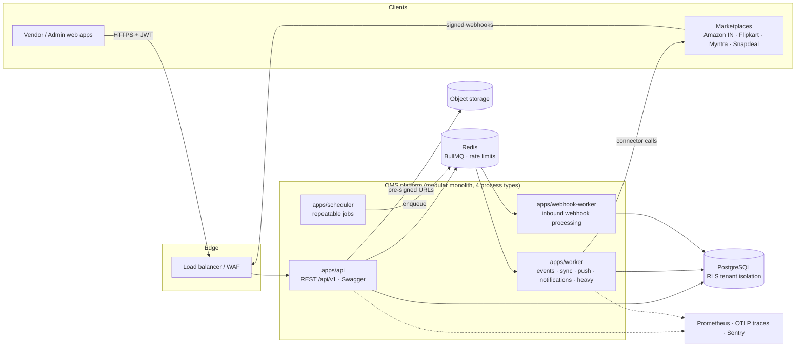

# Architecture

> Stage 1 defined this foundation; **Stage 2 implemented the first real domains on it without restructuring** (identity, vendors, users, categories, attributes, catalog, documents, marketplace accounts, connector framework + sandbox, audit): see [STAGE-2](../stages/STAGE-2.md). Orders, inventory, listings, pricing, webhooks processing and the real marketplace connectors come next on the same seams.

## 1. Principles

1. **One operational source of truth per vendor.** Products, stock and orders live in one canonical model. Marketplaces are *adapters* around it, never the model itself.
2. **Modular monolith first, service-ready by construction.** One deployable codebase, hard internal boundaries (packages, declared dependencies, events). Extracting a module later is a deployment change, not a rewrite.
3. **Tenant isolation is enforced by the platform, not by feature code.** Three independent layers (service, repository, Postgres RLS) so one bug cannot leak data.
4. **Marketplaces differ; the core must not care.** A capability-declaring connector contract isolates every marketplace quirk.
5. **Everything async is idempotent.** At-least-once delivery (outbox, queues, webhooks) is assumed; handlers and endpoints tolerate replays.
6. **Undocumented or unprotected routes cannot exist.** The process refuses to boot (route policy), CI fails (contract test).

## 2. Stack and why

| Concern | Choice | Why |
|---|---|---|
| Language/runtime | TypeScript 6 on Node 20/22 | One language across API, workers and connectors; shared types/contracts |
| HTTP | **Fastify 5** + `fastify-type-provider-zod` | Schema-first: one zod schema = validation + typing + serialisation + OpenAPI. Plugin encapsulation maps well to modules. Fast. |
| Validation/contracts | **zod 4** | Single source of truth for runtime validation and OpenAPI |
| Database | **PostgreSQL 16** | Relational integrity, partial/expression indexes, RLS, JSONB for marketplace-specific payloads, partitioning for log tables |
| ORM | **Drizzle ORM** + `drizzle-kit` | SQL-first and fully typed; composite FKs, partial indexes, check constraints are first class; migrations are plain reviewable SQL; no query-engine binary; plays well with transaction-scoped `set_config` for RLS. (Prisma/TypeORM considered, see [ADR-0003](../adr/README.md).) |
| Queues / jobs | **BullMQ** on **Redis 7** | Retries, backoff, delayed/repeatable jobs (Job Schedulers), concurrency control, dead-letter retention, dashboards |
| Object storage | S3-compatible (AWS S3 / MinIO locally) | Direct pre-signed uploads/downloads; the API never proxies file bytes |
| Logging | pino (JSON) | Fast, structured, redaction built in |
| Metrics / tracing | prom-client, OpenTelemetry (OTLP) | Vendor-neutral |
| Auth | argon2id, JWT (jose, HS256) + rotating opaque refresh tokens | See [SECURITY](../security/SECURITY.md) |
| Tests | Vitest, PGlite (in-process Postgres) | Real migrations + RLS tested without Docker |
| Monorepo | pnpm workspaces, tsup bundling | Fast installs; one bundled artefact per app |

## 3. System context



All four process types are built from the **same codebase and the same composition root** (`@oms/runtime`); they differ only in what they run on top of it.

## 4. Repository layout

```
apps/                         deployable processes (thin: wiring only)
  api/                        Fastify HTTP app, plugins (context, errors, security, access, idempotency, openapi), system routes
  worker/                     BullMQ processors + outbox relay + maintenance jobs
  webhook-worker/             processor for the webhooks-inbound queue
  scheduler/                  registers repeatable jobs (idempotent upserts)
packages/                     shared libraries (no business rules)
  shared/                     AppError + error codes, ids (UUIDv7), pagination, Principal/TenantScope types
  config/                     zod-validated environment, .env loading per NODE_ENV
  logging/                    pino factory, redaction, AsyncLocalStorage request context
  observability/              metrics registry, health registry, error-tracker port, OpenTelemetry bootstrap
  database/                   Drizzle schema, migrations (SQL), withScope()/RLS, repository helpers, seed
  auth/                       argon2id, JWT, refresh tokens, AES-256-GCM SecretBox, RBAC catalogue, HMAC signatures
  contracts/                  shared zod schemas: envelopes, pagination, errors, health
  messaging/                  domain-event envelope, queue catalogue, QueueRegistry (BullMQ)
  storage/                    object-storage port + S3 implementation, tenant key convention
  marketplace-core/           MarketplaceConnector contract, capability model, registry
  module-kit/                 ModuleDefinition, Container, route access types, response helpers
  runtime/                    composition root shared by all apps (config, logger, db, redis, queues, shutdown, ops server, processors, outbox relay)
  testing/                    test app builder (full HTTP stack with in-memory ports)
modules/                      DOMAIN modules, one workspace package each (@oms/mod-*): see MODULES.md
  registry/                   generated list of all modules (apps load modules only through here)
integrations/marketplace/     connector implementations (adapters)
  amazon-in/ flipkart/ myntra/ snapdeal/    one package each
  registry/                   the only place that knows every connector
infrastructure/               Dockerfile, postgres bootstrap, observability configs, k8s base manifests
docs/                         architecture · api · database · security · integrations · development · deployment · testing · adr
tests/                        unit · integration · api · database · contract · connector · e2e (+ helpers)
scripts/                      scaffold-modules, check-modules, export-openapi, tsup-app
```

### Layers and the dependency rule

```
HTTP layer        apps/api plugins + each module's http/        (Fastify routes, zod schemas)        -> application
Application       modules/*/application                          (use-cases, transactions, events)    -> domain, infrastructure
Domain            modules/*/domain                               (entities, state machines, policies; pure, no I/O)
Data access       modules/*/infrastructure + @oms/database       (tenant-scoped repositories)
Integrations      integrations/marketplace/*                     (adapters; no DB access, no business rules)
Background        apps/worker, apps/webhook-worker, scheduler    (call the same application services as HTTP)
```

Dependencies point **down and inward** only. Domain code imports nothing from HTTP or infrastructure. Connectors never touch the database: the host hands them decrypted credentials per call and persists whatever they return.

## 5. Module boundaries

28 domain modules (Identity, Vendors, Users, Categories, Attributes, Catalog, Documents, Warehouses, Inventory, Marketplace Accounts/Connectors, Listings, Pricing, Orders, Fulfillment, Shipping, Returns, Notifications, Jobs, Sync, Webhooks, Reports, Analytics, Billing, AI, Automation, Audit, Platform Admin) are declared in [MODULES.md](MODULES.md) with **responsibility, owned tables, API prefixes, dependencies, published and consumed events**. That file is *generated* from `scripts/scaffold-modules.mjs`, and `pnpm check:modules` (CI) guarantees:

- the declared dependency graph is **acyclic**,
- each manifest's `dependsOn` equals the `@oms/mod-*` dependencies in its `package.json` (no hidden coupling),
- every consumed event is published by someone,
- modules import each other **only through the package entry point**.

Rules of thumb for module authors:

1. A module is the **only writer** of the tables it owns. Others read through its public service interface or react to its events.
2. Prefer **events** to synchronous calls across modules; use `dependsOn` only for queries that must be consistent.
3. Never import another module's `domain/` or `infrastructure/`.

## 6. Events and background processing

```mermaid
sequenceDiagram
  participant H as HTTP handler / job
  participant DB as PostgreSQL
  participant R as Outbox relay (worker)
  participant Q as Redis queue "domain-events"
  participant C as Module consumers (worker)
  H->>DB: BEGIN; change state; INSERT outbox_events; COMMIT
  R->>DB: SELECT ... FOR UPDATE SKIP LOCKED (unpublished)
  R->>Q: enqueue (jobId = event id, dedupes)
  R->>DB: mark published
  Q->>C: deliver (at-least-once, retried with backoff)
  C->>DB: idempotent handling
```

- **Transactional outbox** (`outbox_events`): an event exists *iff* the state change committed. The relay is safe to run in many replicas.
- **Delivery is at-least-once.** Consumers must be idempotent. `correlationId` follows the flow from the HTTP request, through the event, into the worker logs.
- **Queues** are declared once in `@oms/messaging` (`QUEUES`): `domain-events`, `webhooks-inbound`, `sync-marketplace`, `marketplace-push`, `notifications`, `heavy`, `maintenance`. Separate queues stop one workload (a marketplace outage) from starving another. Each has bounded exponential-backoff retries; failed jobs are retained 7 days as the dead-letter view.
- **Scheduler** registers repeatable jobs as BullMQ Job Schedulers (idempotent upserts, Redis coordinated), so several replicas never double-fire. Stale schedules are removed on boot.
- **Graceful shutdown**: SIGTERM stops accepting work, lets in-flight jobs/requests finish, then closes queues, DB pool, Redis and tracing, in reverse registration order.

## 7. Marketplace connector architecture

See [CONNECTORS.md](../integrations/CONNECTORS.md). Summary: a `MarketplaceConnector` declares a **capability matrix** (auth model, orders fetch/webhook/ack/cancel, inventory/price push, listings, shipping, returns, rate limits). Core code asks capabilities before acting. New marketplace = new package under `integrations/marketplace/<name>` + one line in the connector registry. No core change.

## 8. Multi-tenancy

See [MULTI_TENANCY.md](MULTI_TENANCY.md). Summary: `vendor_id` on every tenant row; tenant derived **only** from the verified token; three enforcement layers: service/scope, repository filter, **PostgreSQL row-level security** driven by transaction-local session variables. Composite `(vendor_id, id)` foreign keys make cross-tenant references impossible at the schema level.

## 9. Cross-cutting concerns

| Concern | Where | Doc |
|---|---|---|
| Authentication, RBAC, encryption | `@oms/auth`, `apps/api/src/plugins/access.ts` | [SECURITY](../security/SECURITY.md) |
| API conventions, OpenAPI | `@oms/contracts`, `plugins/openapi.ts`, `plugins/route-policy.ts` | [API](../api/API.md) |
| Logs, metrics, traces, health | `@oms/logging`, `@oms/observability` | [OBSERVABILITY](OBSERVABILITY.md) |
| Configuration | `@oms/config`, `.env.example` | [DEVELOPMENT](../development/DEVELOPMENT.md) |
| Schema, migrations | `@oms/database` | [DATABASE](../database/DATABASE.md) |

## 10. Scaling model

| Layer | How it scales |
|---|---|
| API | Stateless; horizontal; Redis-backed rate limits hold across replicas |
| Workers | Horizontal per queue pool (`WORKER_QUEUES`); scale on queue depth (KEDA) |
| Marketplace load | Per-account rate limiting + batching inside connectors; `marketplace-push` isolated from other queues |
| PostgreSQL | Every hot query is tenant-leading-indexed. Vertical + read replicas first; **partition** `sync_logs`/`audit_logs`/`order*` by time (and later hash on `vendor_id`) when volume demands; very large tenants can be moved to a dedicated database because `vendor_id` is the universal key |
| Redis | Single primary + replicas; BullMQ requires `noeviction`. Shard queues by prefix per marketplace if one cluster saturates |

## 11. Which modules could become microservices later

The monolith is the right starting point; extraction is triggered by **independent scaling, independent failure/blast-radius, different runtime, or team ownership**, never by fashion. Each module's `extraction` rating in [MODULES.md](MODULES.md) is the shortlist:

| Priority | Module | Why it would split | Seam already in place |
|---|---|---|---|
| **Early** | **Sync + Marketplace Connectors** | Spiky, I/O-bound, hits third-party rate limits and outages; needs its own scaling and failure isolation | Own queues, `MarketplaceConnector` port, no DB access in connectors, sync tables owned solely by `sync` |
| **Early** | **Webhooks** (ingest + process) | Public, bursty, must stay up when everything else is down; ACK-fast then process | Already its own process (`webhook-worker`) and queue; ingestion only verifies + enqueues |
| **Early** | **Inventory** | Highest write contention (reservations), strict consistency; benefits from dedicated DB tuning | Sole writer of `inventory`; interactions via events (`order.created` → reserve) |
| **Early** | **Orders** | High volume, partition-heavy | Idempotent ingestion keyed by `(account, external id)`; outbox events |
| **Early** | **Notifications** | Different runtime profile (email/SMS providers), fire-and-forget | Pure event consumer |
| **Early** | **Analytics / Reports** | Heavy reads should not compete with OLTP; can use a replica/warehouse | Event-fed read models; read-only |
| **Early** | **AI** | Different compute/vendor profile, quotas, latency | Behind a gateway port; consumes events |
| **Early** | **Audit** | Append-only, high write, separate retention/compliance | Event-fed, append-only table with immutability trigger |
| Later | Identity, Catalog, Documents, Listings, Pricing, Billing, Fulfillment/Shipping/Returns, Automation, Marketplace Accounts | Extract when a team/scale need appears | Same patterns (own tables, events) |
| Keep | Vendors, Users, Categories, Attributes, Warehouses, Jobs, Platform Admin | Small, tightly coupled to tenancy/identity | n/a |

**How an extraction works** (no restructuring): (1) run the module in a second process with the same `@oms/runtime` composition root, (2) give it its own database schema/role (tables are already single-writer), (3) replace the few synchronous `dependsOn` calls with events or a small HTTP/RPC client behind the same interface, (4) route its prefix at the gateway. The outbox + queues are already the transport.

## 12. Decisions and trade-offs

Recorded in [docs/adr](../adr/README.md). Notable ones: modular monolith over microservices; Drizzle over Prisma; RLS as defence in depth; outbox over dual-writes; HS256 JWT now with a documented path to asymmetric keys; keyset pagination.
