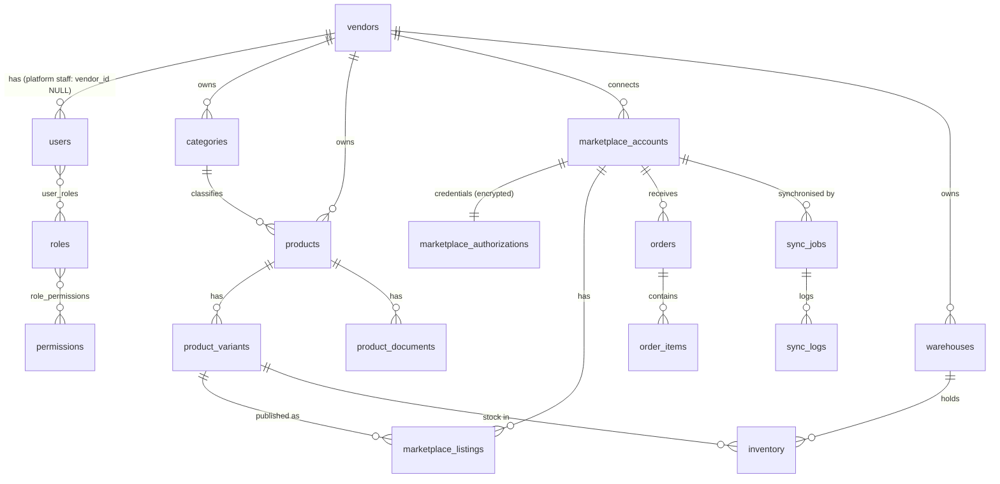

# Database

PostgreSQL 16 · Drizzle ORM (`packages/database`) · migrations are plain SQL in `packages/database/migrations` (reviewed like code).

## 1. Tooling and workflow

| Task | Command |
|---|---|
| Edit schema | `packages/database/src/schema/*.ts` |
| Generate migration from schema diff | `pnpm db:generate` (then **review the SQL**) |
| Hand-written migration (RLS, triggers, data fixes) | `pnpm --filter @oms/database exec drizzle-kit generate --custom --name=<what>` |
| Apply | `pnpm db:migrate` (uses `DATABASE_MIGRATION_URL`, the owner role) |
| Reference data (permissions, system roles) | `pnpm db:seed` (idempotent; safe every deploy) |

Rules: migrations are **forward-only and additive by default** (expand → migrate data → contract across releases so old and new app versions run together during a rolling deploy). Never edit an applied migration.

**Two roles.** `oms_owner` owns the schema (migrations/seed only). `oms_app` is the runtime role: `NOSUPERUSER NOBYPASSRLS` and *not owner*, so RLS always applies. See `infrastructure/postgres/init.sql`.

## 2. Naming conventions

- Tables `snake_case` plural (`product_variants`); columns `snake_case`; FKs `<entity>_id`.
- Constraints/indexes are explicitly named: `<table>_<cols>_uq` (unique), `<table>_<cols>_idx`, `<table>_<what>_chk` (check), `<table>_<ref>_fk` (composite FK).
- Enforced by `tests/database/schema-conventions.test.ts`.

## 3. Column conventions

| Concern | Convention |
|---|---|
| Primary key | `id uuid`, **UUIDv7** generated in the app (time-ordered → no random-page index bloat, still unguessable-enough, safe to expose); DB default `gen_random_uuid()` as safety net |
| Tenant | `vendor_id uuid NOT NULL` right after `id` on every tenant table |
| Timestamps | `created_at`, `updated_at` `timestamptz` (UTC); `updated_at` also maintained by a DB trigger |
| Soft delete | `deleted_at timestamptz NULL` **only on user-managed master data** (vendors, users, categories, products, variants, documents, warehouses). Unique indexes are *partial* (`WHERE deleted_at IS NULL`) so codes can be reused after deletion. Transactional/log tables (orders, sync, audit) are never deleted. |
| Optimistic locking | `version int` bumped per update; updates use `WHERE id = ? AND version = ?` and return `VERSION_CONFLICT` (409) on 0 rows |
| Status | `text` + `CHECK (status IN (...))`, not pg enums (adding a value is a cheap constraint swap, not an `ALTER TYPE`) |
| Money | integer **minor units** (`*_minor bigint`) + `currency char(3)`; never floats. Tax rates in basis points (`*_bps`). |
| External ids | `external_*` text; uniqueness is always scoped: `(marketplace_account_id, external_*_id)` |
| Flexible data | `jsonb` only for genuinely marketplace-specific payloads/overrides; anything queried or constrained gets real columns |

## 4. Tables (Stage 1 foundation)

| Table | Purpose | Key constraints / indexes |
|---|---|---|
| `vendors` | Tenant root | `slug` unique (live rows); status check |
| `users` | Login identities | `lower(email)` unique (live); `CHECK` platform ⇔ `vendor_id IS NULL`; lockout columns |
| `roles`, `permissions`, `role_permissions`, `user_roles` | RBAC. `roles.vendor_id NULL` = system role | unique `(coalesce(vendor_id), key)` |
| `refresh_tokens` | Rotating opaque tokens, **hashed** | unique `token_hash`; `family_id` for reuse detection |
| `categories` | Vendor category tree, materialised `path` | unique `(vendor_id, slug)` live; composite self-FK; `text_pattern_ops` index for subtree prefix queries |
| `products` | Canonical product | unique `(vendor_id, product_code)` live; `(vendor_id, status, id)`; `(vendor_id, created_at desc, id)` for keyset lists; trigram GIN on `title` for search |
| `product_variants` | SKUs | unique `(vendor_id, sku)` live; composite FK to products; price ≥ 0 check |
| `product_documents` | Image/document metadata (bytes live in object storage) | unique `storage_key`; **one primary per product** (partial unique); composite FKs |
| `marketplace_accounts` | Seller account per marketplace | unique `(vendor_id, marketplace, external_account_id)`; marketplace check |
| `marketplace_authorizations` | **Encrypted** credentials (`credentials_ciphertext`, `encryption_key_id`) | 1:1 with account; partial index on expiring tokens for the refresh job |
| `marketplace_listings` | Variant ↔ marketplace listing | unique `(account, external_listing_id)`, `(account, external_sku)`, `(account, variant)`; `sync_hash` to skip no-op pushes |
| `warehouses` | Fulfilment locations | unique `(vendor_id, code)` live; **one default per vendor** (partial unique) |
| `inventory` | Stock per variant × warehouse | unique `(vendor_id, variant_id, warehouse_id)`; `CHECK on_hand ≥ 0 AND reserved ≥ 0 AND reserved ≤ on_hand` |
| `orders` | Normalised marketplace order | **unique `(marketplace_account_id, external_order_id)` = ingestion idempotency key**; unique `(vendor_id, order_number)`; keyset indexes `(vendor_id, status, placed_at desc, id)` |
| `order_items` | Lines | unique `(order_id, external_item_id)`; qty > 0 |
| `sync_jobs` | One sync run per account | **unique `(vendor_id, idempotency_key)`**; partial index on active runs; resumable `cursor` |
| `sync_logs` | Append-only run log (high volume) | `(vendor_id, sync_job_id, id)`; partition candidate |
| `audit_logs` | Append-only audit trail | immutable via trigger; `(vendor_id, created_at desc, id)`, resource and actor indexes |
| `idempotency_keys` | HTTP `Idempotency-Key` store | unique `(coalesce(vendor), scope, key)`; TTL purge job |
| `outbox_events` | Transactional outbox | partial index on unpublished |

## 5. Tenant integrity and RLS

- **Composite FKs**: every cross-entity FK on tenant tables is `(vendor_id, x_id) → x(vendor_id, id)`. A row can never reference another vendor's row. (`UNIQUE (vendor_id, id)` is a *table constraint*, not a partial index, which is required for an FK target.)
- **RLS** on every table with `vendor_id` (+ `vendors` itself): see [MULTI_TENANCY](../architecture/MULTI_TENANCY.md). Applied via `enable_tenant_rls('table')`.
- **Adding a table**: in its migration, after `CREATE TABLE`, add `SELECT enable_tenant_rls('my_table');` and `SELECT attach_updated_at('my_table');` (if it has `updated_at`).
- `audit_logs` is append-only (trigger blocks UPDATE/DELETE; runtime role also has UPDATE/DELETE/TRUNCATE revoked).

All of the above is executed against the real migrations in CI (`tests/database`, PGlite).

## 6. Index strategy

1. Every tenant table has at least one index **starting with `vendor_id`**.
2. Lists use **keyset pagination**: indexes end with `(…, id)` to give a total order, so deep pages are O(log n) and stable under concurrent inserts.
3. Uniqueness is the first line of defence for idempotency (orders, listings, sync jobs, idempotency keys).
4. Partial indexes keep hot/rare paths small (live rows only, unpublished outbox, active sync jobs, expiring tokens).
5. Add indexes from measured slow queries (`pg_stat_statements`), not speculatively.

## 7. Scaling plan

| Pressure | Step |
|---|---|
| Connections | PgBouncer in **transaction** mode (works: `set_config(..., true)` is transaction-local) |
| Read load (reports/analytics) | Read replicas; analytics read models fed by events |
| Large append-only tables | Declarative **range partitioning by month** for `sync_logs`, `audit_logs`, later `orders`; retention = drop partition (also the only sanctioned way to purge audit data) |
| Very large tenants / regulatory isolation | Move a tenant to its own database: `vendor_id` is already the universal key and all references are tenant-composite |
| Hot rows (inventory) | Short transactions, `UPDATE … WHERE version = ?`, per-variant queueing in the Inventory module; extract to its own DB if needed |

## 8. Backup, retention, data protection

- PITR enabled (WAL archiving) + daily snapshots; restore drills quarterly. RPO ≤ 5 min, RTO ≤ 1 h targets.
- Marketplace credentials are encrypted at the application layer (AES-256-GCM, AAD-bound to the row), so DB dumps/replicas do not expose them.
- Buyer PII in `orders.buyer/shipping_address`: treat as personal data; field-level encryption and retention rules are applied in the Orders module (Stage 3) per marketplace policy.

## Stage 2 schema additions (migrations `0002`, `0003`)

| Table | Purpose |
|---|---|
| `user_tokens` | single-use e-mail verification / password-reset tokens (sha256 hash, purpose, expiry, `used_at`); consumed with an atomic `UPDATE … WHERE used_at IS NULL AND expires_at > now() RETURNING` |
| `invitations` | vendor invitations; partial unique `(vendor_id, lower(email)) WHERE status='pending'` |
| `attribute_definitions`, `attribute_values`, `category_attributes`, `product_attribute_values` | generic typed attribute system; one typed value column per row; unique `(product, coalesce(variant), attribute)` |
| `product_marketplace_data` | marketplace-**specific** payload per `(product, marketplace)`: keeps the core product marketplace-neutral |
| `data_jobs` | CSV import/export runs (status, stats, first 200 row errors, storage keys) |
| `vendors` (+cols) | business profile: `business_email, phone, gstin, pan, address, timezone, currency, status_reason` |
| `users` (+col) | `email_verified_at` |
| `products` (+cols) | `manufacturer, country_of_origin, hsn_code, gst_rate_bps, tags` |
| `product_variants` | partial **unique** `(vendor_id, barcode)` for live rows |
| `product_documents` (+cols) | `purpose` (product_image / product_document / listing_document), `listing_id` (FK arrives with Listings) |
| `marketplace_accounts` (+cols) | `mode` (live/sandbox), `connection_status`, `last_success_at`, `last_failure_at`, `last_failure_message`; `mock` added to the marketplace check |
| `marketplace_authorizations` (+col) | `rotation_count` |

Notes learned the hard way: a composite-FK target must be a real `UNIQUE` **constraint** (not a later-created index) so it exists when the FK is created; subqueries inside Drizzle `sql` templates must qualify outer columns explicitly (`"products"."id"`), otherwise they bind to the inner table.
Every new tenant table is registered with `SELECT enable_tenant_rls('…')` in `0003_stage2_rls.sql`.
